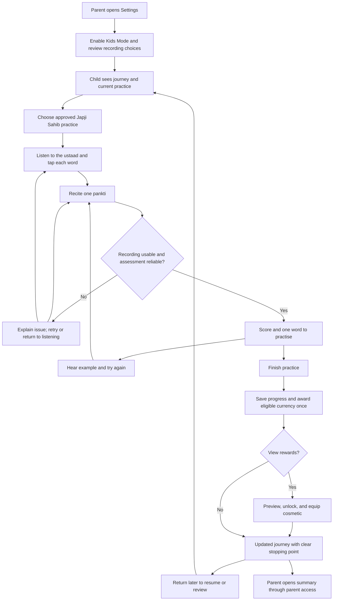

# User journey and screen behavior

Draft for team review. Last updated October 16, 2026. [Context index](README.md).

## User journey

| Stage | Child or parent need | Action and response | Completion signal |
| --- | --- | --- | --- |
| Parent setup | Understand and control the experience | Enable Kids Mode; review local recording default; allow microphone when needed | Kids Mode state saved; no upload consent inferred |
| Journey home | Know where to start | See current node and Continue practice | Correct practice opens |
| Practice introduction | Understand today's small goal | See selected pauri and one pankti to recite; hear instructions | Child starts listening |
| Follow along | Connect sound and written words | Tap words in time, pause or replay | Tap results saved separately from pronunciation results |
| Recitation | Try without pressure | Start recording; see position highlight and Stop | Usable recording or actionable retry message |
| Feedback | Know exactly what to improve | Hear one reference word and a short hint | Child can replay and retry that word |
| Finish | Recognize effort and progress | See completed practice and any earned currency | Progress persists; award is not duplicated |
| Reward | Personalize the experience | Preview, unlock if affordable, then equip | Balance and selection persist |
| Return | Resume without shame | See next step or review word | Practice remains accessible after a missed day |
| Parent review | Understand progress without supervising every attempt | Read summary; manage or delete recordings | Summary matches saved practice; deletion works |

## Screen-by-screen storyboard for Paper

Current proposed visual direction: parchment backgrounds, dark green ink, moss green actions, pale leaf surfaces, and brass reward accents. This botanical direction supersedes the earlier navy and teal prose. Use readable Gurmukhi type with generous line spacing. Keep the prayer reading area visually quiet. Reward controls appear after practice, not over sacred text. Colors, typography, and artwork are proposals, not Khalis brand standards.

### 1. Parent settings

A simple settings page with Kids Mode at the top, a short purpose statement, and a toggle. Below it, a recording card says: "Recordings stay on this device by default." Show microphone status and Manage recordings. Any optional upload must have a separate parent choice explaining destination and purpose. V1 can omit upload entirely.

Primary action: Enable Kids Mode. Parent access method remains a decision; a decorative lock icon alone is not an access control.

### 2. Your journey

Top: chosen avatar and small currency balance. Center: a short path of practice nodes, with the current node labeled "Japji Sahib: your next practice." Bottom: a prominent Continue practice button and a quiet Rewards link.

For first use, show a welcome explanation and the first node. For returning use, resume the saved step. Do not show fabricated completion or balances in a functional build.

### 3. Today's practice

Show bani and pauri identification, a simple sequence of Listen, Follow, Recite, and the selected text from the approved source. Make the expected activity clear without claiming a fixed completion time.

Primary action: Listen and follow. Secondary action: Hear the example first. A familiar learner may go directly to recitation as a proposed convenience, but currency must not require unnecessary repeat tapping.

### 4. Listen and tap

Make Gurmukhi text the main content. Highlight the currently recited word. Place Play/Pause and Replay below the text. A correct tap receives a calm highlight; a missed or incorrect tap receives the requested underline plus a non-color cue. No moving rewards or race clock compete with reading.

Primary action at the end: Try reciting. Secondary action: Listen again. Timing results describe following the audio, never pronunciation mastery. Preserve word timing after pausing, seeking, and replaying.

### 5. Your turn

Show the selected pankti, a microphone control, and clear states: Ready, Listening, and Reviewing. During recording, highlight the tracked word. If tracking becomes uncertain, pause the position indicator rather than confidently highlighting an incorrect word.

Primary action: Start recording, changing to Stop. Secondary action: Hear example. For denied microphone access, provide a settings explanation and allow listening to continue.

### 6. One thing to practise

Show a score only when reliable and validated for this use. Label its scale and meaning. Below it, give one target word, its place in the pankti, a Play example control, and a short rule grounded in the ustaad's guidance.

Primary action: Practise this word. Secondary action: Finish for now. If audio is noisy or judgment uncertain, say "I couldn't hear that clearly. Try again somewhere quieter." Do not invent a low score or a weakest word. Example scores on a future canvas must be labeled illustrative.

### 7. Practice complete

Show the completed practice, the word revisited, and the exact reason for any award. Distinguish "You practised this pankti" from "You demonstrated this word correctly." A gentle visual acknowledgment may be used, with reduced-motion support.

Primary action: Back to journey. Secondary action: View rewards. End with a clear permission to stop: "Your practice is saved."

### 8. Your collection

A small grid of neutral fictional avatars or accessories with clear prices, locked/unlocked states, and an equipped state. Show the balance once. Preview before unlocking. Insufficient funds explain what is needed without pressure or purchases.

Historical Sikh figures, religious symbols, currency naming, and character treatment require cultural review. The transcript brainstorm does not establish approval for any specific depiction. Proposed V1 uses simple neutral assets until that review.

### 9. Parent summary

Show the practiced section, recent practice days, words needing review, and demonstrated improvements when supported by reliable assessments. Keep completed practice, complete banis, and word mastery distinct. One pauri is not a completed bani.

Provide Manage recordings and Exit Kids Mode through parent access. No comparative child rankings. The parent summary is descriptive and is not a religious proficiency certification.

## Recovery and accessibility

| Condition | Proposed response |
| --- | --- |
| Microphone denied | Explain how to enable it and keep listening available |
| Silence, noise, or uncertain score | Give a neutral retry prompt; no invented score or currency penalty |
| Alignment loses position | Stop misleading highlighting; let the child replay or restart the pankti |
| Reference audio unavailable | Explain that this practice cannot start; offer downloaded practice only if available |
| App closed mid-practice | Restore the last saved stage without duplicating rewards |
| Child wants to stop | Save progress and provide an obvious exit |
| Insufficient currency | Keep preview available; show cost and balance without urgency |
| Recording deletion | Remove the selected local recording and confirm; explain any retained progress metadata |

Support text enlargement, accessible control labels, non-color feedback, reduced motion, and comfortable tap targets. Test Gurmukhi rendering and word wrapping on the actual target device. Readability and sacred-text integrity take precedence over decorative layout.
