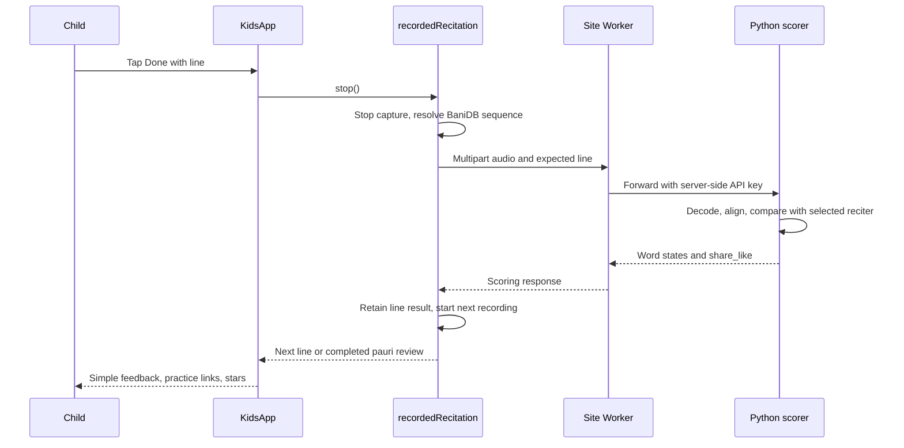

# Architecture and code tour

## One line through the system

On a native device the scoring client currently talks directly to its configured endpoint. A production gateway must authenticate device requests without embedding a shared server secret.

## Where to make a change

- `native-app/App.tsx` loads saved experience and supplies platform adapters. It is the boundary between the learning UI and Expo.
- `native-app/src/KidsMode/KidsApp.tsx` owns navigation and learning state. Six map panels are intentional. `go()` stops playback and cancels abandoned recordings; avoid bypassing it for screen changes.
- `native-app/src/KidsMode/types.ts` defines `HostPorts`. The learning UI receives audio, recording, storage, images, sheets, and scrolling through these ports rather than implementing each platform itself.
- `native-app/src/host/recordedRecitation.ts` owns one-line recording, retry, and assembly of pauri results. `perLineRef` preserves successful earlier lines when a later line needs retrying.
- `native-app/src/scoring/client.ts` builds multipart requests, handles timeouts, and normalizes the service response. `seqsForPauri()` maps UI pauri/line positions to BaniDB sequence IDs; do not assume every pauri has six lines.
- `native-host/worker.mjs` forwards only approved scoring routes and adds the server-held key. It does not contain the ML model.
- `demo-server/demo_server.py` validates request ranges, owns the loaded model, and provides the HTTP API. A lock serializes model inference and reference-cache population.
- `demo-server/phone_score.py` computes word flags using aligned model emissions and the selected reciter's reference values. The CLI writes score reports; the API calls scoring functions without those CLI report writes.
- `native-app/src/KidsMode/WordReview.tsx` renders the service's word states and short practice prompts. This is where child-facing wording belongs.

## Content, progress, and rewards

`src/bani.json` stores Gurmukhi, transliteration, English meaning, and reference-audio timestamps. Transliteration is a reading aid; it is not fed to the scoring service as the child's transcript. `story-plans.json` maps pauri lines to visual landmarks. Asset names resolve through static imports in `src/host/images.ts`, which Metro can bundle for native builds.

`experience.ts` validates saved data before using it. Old frame fields are ignored while coins, stars, and other valid progress survive. `rewards.ts` awards ten coins per newly earned star, so replaying the same result cannot farm coins. `wardrobe.ts` combines purchase, ownership, and equipping in a single transition. Clothing, belongings, and actions occupy independent slots. `RewardsScreen.tsx` keeps its demo wallet separate from real progress.

## Important distinctions

- Service word states are `like`, `check`, or `unclear`, not calibrated per-word accuracy percentages.
- A line's percentage describes agreement with the selected reciter among words that could be judged. It is not a clinical or educational assessment.
- The service publishes star bands, but current reward thresholds are also defined in `rewards.ts`. Keep both consistent until there is one shared source of truth.
- The local MFCC/DTW scorer is a separate experimental path, not the deployed IndicConformer packaged into the phone.
- UI state is stored on the device/browser. The application has no deployed teacher dashboard or cross-device account sync.
