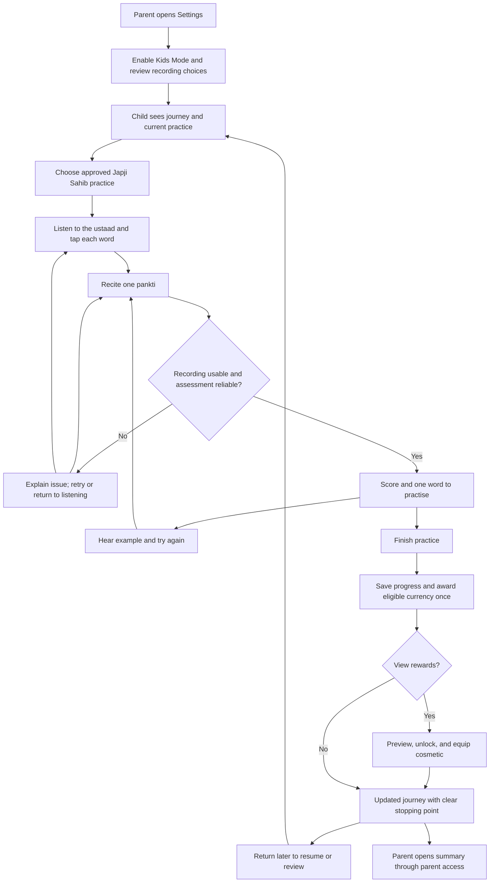

# Uchaaran Helper V1

Product document and user journey for team review. October 16, 2026.

This is a proposed product specification, not an implemented or validated app. The [editable Paper review file](https://app.paper.design/file/01M533NG24KGRMXNQQ6EX5Z1BJ/p-1-0) contains eight visually reviewed boards, including nine annotated screen concepts. These are planning wireframes, not a working prototype.

## Purpose

Help children practise Gurbani with sustained attention and improve their uchaaran against an ustaad's standard. Give them a clear path through practice and meaningful reasons to return.

The first audience is students in grades 6 through 8. Parents enable Kids Mode in Sundar Gutka and control recording permissions. An ustaad supplies reference recordings, pronunciation rules, and judgments used to validate feedback.

Pronunciation is the first learning outcome. Translation, interpretation, and broader understanding of Gurbani are outside this V1 specification.

## Sources and decision status

| Source | What it establishes |
| --- | --- |
| Khalis Foundation challenge brief, supplied by Gurasees on October 16 | Kids Mode, ustaad reference recordings and English rules, pronunciation scoring, weakest-word feedback, synchronized tap-along, voice-following, local recording default, validation, five-minute demo, MIT code license |
| [Gamification ideas for app engagement](https://notes.granola.ai/d/7e3f0945-3b07-4cfb-81d3-1fa4d3198351), October 16 | Grades 6 through 8; journey and earned currency as initial gamification priorities; map the complete user flow before building |
| [Project README](../README.md) | Repeats the pronunciation, alignment, feedback, progress, parental control, and validation requirements |

The brief and meeting are requirements sources, not evidence that technical performance has already been achieved. The meeting transcript has transcription errors and unnamed speakers; this document assigns no individual commitments.

Everything labeled Proposed below is a design recommendation for review, not a meeting decision. The brief's scientific claims and usage figures are not independently verified here and are not needed to define V1.

## The first complete experience

Proposed: a child practises one approved pauri of Japji Sahib, listens and taps along, then recites one pankti. The app follows their voice, identifies one word to revisit, plays the ustaad's example, and lets them retry. Completing meaningful practice advances a journey node and earns a small amount of currency. A parent can see what was practised and what still needs attention.

The full product direction is Kids Mode within Sundar Gutka. Whether the first demonstration runs inside that app or in a standalone prototype is an open team decision. A standalone demo must not be described as a completed integration.

## V1 scope

| Element | V1 behavior | Basis |
| --- | --- | --- |
| Parent setup | Settings entry, Kids Mode switch, plain recording explanation, parent-controlled recording options | Brief; exact gate design proposed |
| Journey | One small path with an obvious current node, completed nodes, and the next practice step | Meeting; exact path proposed |
| Content selection | Japji Sahib with one approved pauri available; future content visibly unavailable | Proposed demo boundary from brief |
| Listen and tap | Audio follows approved word timings; correct taps highlight words; misses have a red underline and a text/icon cue | Brief; non-color cue proposed |
| Recite | Record one pankti, follow the child's position word by word, then assess pronunciation | Brief |
| Feedback | Show a pronunciation score, name the weakest reliably assessed word, replay its reference, give an ustaad-grounded hint | Brief; confidence handling proposed |
| Retry | Practise the target word and retry the pankti without losing progress | Proposed |
| Currency | Earn through completed attentive practice and validated pronunciation progress | Meeting; earning rules proposed |
| Rewards | Small collection of cosmetic avatars or accessories, with preview and equip controls | Meeting; exact catalog proposed |
| Progress | Practice history, simple streak, and separate completion versus demonstrated skill labels | Brief; definitions proposed |
| Parent summary | Practice completed, words to revisit, demonstrated progress, recording controls | Brief; exact layout proposed |
| Validation | Compare model judgments with ustaad judgments and alignment with hand-marked timings | Brief |

## User journey

| Stage | Child or parent need | Action and response | Completion signal |
| --- | --- | --- | --- |
| Parent setup | Understand and control the experience | Enable Kids Mode; review local recording default; allow microphone when needed | Kids Mode state saved; no upload consent inferred |
| Journey home | Know where to start | See current node and Continue practice | Correct practice opens |
| Practice introduction | Understand today's small goal | See selected pauri and one pankti to recite; hear instructions | Child starts listening |
| Follow along | Connect sound and written words | Tap words in time, pause or replay | Tap results saved separately from pronunciation results |
| Recitation | Try without pressure | Start recording; see position highlight and Stop | Usable recording or actionable retry message |
| Feedback | Know exactly what to improve | Hear one reference word and a short hint | Child can replay and retry that word |
| Finish | Recognize effort and progress | See completed practice and any earned currency | Progress persists; award is not duplicated |
| Reward | Personalize the experience | Preview, unlock if affordable, then equip | Balance and selection persist |
| Return | Resume without shame | See next step or review word | Practice remains accessible after a missed day |
| Parent review | Understand progress without supervising every attempt | Read summary; manage or delete recordings | Summary matches saved practice; deletion works |

## Screen-by-screen storyboard for Paper

Current proposed visual direction: parchment backgrounds, dark green ink, moss green actions, pale leaf surfaces, and brass reward accents. This botanical direction supersedes the earlier navy and teal prose. Use readable Gurmukhi type with generous line spacing. Keep the prayer reading area visually quiet. Reward controls appear after practice, not over sacred text. Colors, typography, and artwork are proposals, not Khalis brand standards.

### 1. Parent settings

A simple settings page with Kids Mode at the top, a short purpose statement, and a toggle. Below it, a recording card says: "Recordings stay on this device by default." Show microphone status and Manage recordings. Any optional upload must have a separate parent choice explaining destination and purpose. V1 can omit upload entirely.

Primary action: Enable Kids Mode. Parent access method remains a decision; a decorative lock icon alone is not an access control.

### 2. Your journey

Top: chosen avatar and small currency balance. Center: a short path of practice nodes, with the current node labeled "Japji Sahib: your next practice." Bottom: a prominent Continue practice button and a quiet Rewards link.

For first use, show a welcome explanation and the first node. For returning use, resume the saved step. Do not show fabricated completion or balances in a functional build.

### 3. Today's practice

Show bani and pauri identification, a simple sequence of Listen, Follow, Recite, and the selected text from the approved source. Make the expected activity clear without claiming a fixed completion time.

Primary action: Listen and follow. Secondary action: Hear the example first. A familiar learner may go directly to recitation as a proposed convenience, but currency must not require unnecessary repeat tapping.

### 4. Listen and tap

Make Gurmukhi text the main content. Highlight the currently recited word. Place Play/Pause and Replay below the text. A correct tap receives a calm highlight; a missed or incorrect tap receives the requested underline plus a non-color cue. No moving rewards or race clock compete with reading.

Primary action at the end: Try reciting. Secondary action: Listen again. Timing results describe following the audio, never pronunciation mastery. Preserve word timing after pausing, seeking, and replaying.

### 5. Your turn

Show the selected pankti, a microphone control, and clear states: Ready, Listening, and Reviewing. During recording, highlight the tracked word. If tracking becomes uncertain, pause the position indicator rather than confidently highlighting an incorrect word.

Primary action: Start recording, changing to Stop. Secondary action: Hear example. For denied microphone access, provide a settings explanation and allow listening to continue.

### 6. One thing to practise

Show a score only when reliable and validated for this use. Label its scale and meaning. Below it, give one target word, its place in the pankti, a Play example control, and a short rule grounded in the ustaad's guidance.

Primary action: Practise this word. Secondary action: Finish for now. If audio is noisy or judgment uncertain, say "I couldn't hear that clearly. Try again somewhere quieter." Do not invent a low score or a weakest word. Example scores on a future canvas must be labeled illustrative.

### 7. Practice complete

Show the completed practice, the word revisited, and the exact reason for any award. Distinguish "You practised this pankti" from "You demonstrated this word correctly." A gentle visual acknowledgment may be used, with reduced-motion support.

Primary action: Back to journey. Secondary action: View rewards. End with a clear permission to stop: "Your practice is saved."

### 8. Your collection

A small grid of neutral fictional avatars or accessories with clear prices, locked/unlocked states, and an equipped state. Show the balance once. Preview before unlocking. Insufficient funds explain what is needed without pressure or purchases.

Historical Sikh figures, religious symbols, currency naming, and character treatment require cultural review. The transcript brainstorm does not establish approval for any specific depiction. Proposed V1 uses simple neutral assets until that review.

### 9. Parent summary

Show the practiced section, recent practice days, words needing review, and demonstrated improvements when supported by reliable assessments. Keep completed practice, complete banis, and word mastery distinct. One pauri is not a completed bani.

Provide Manage recordings and Exit Kids Mode through parent access. No comparative child rankings. The parent summary is descriptive and is not a religious proficiency certification.

## Progress and rewards rules

Proposed rules for review:

- Use a neutral working name, "practice points," until the team chooses a culturally appropriate currency name.
- Award once for a completed eligible practice activity. Give a separate improvement award only when reliable assessment supports it. Exact amounts remain open.
- Replays, app-open events, screen time, and repeated taps alone earn nothing.
- Retries are encouraged and unrestricted. They do not repeatedly award the same completion credit.
- Interrupted sessions resume from saved progress. Finishing the same session twice must not issue two awards.
- Cosmetic purchases cannot lock access to Gurbani or required learning activities. No paid currency, random rewards, leaderboards, or competitive pronunciation rankings in V1.
- A streak records practice days and offers encouragement. A missed day does not remove earned items or block the journey.
- Call a word "practised" until a reviewed mastery rule is met. Do not equate one good attempt with durable mastery.
- A small finite V1 collection is acceptable. Further content can extend the journey later; endless unlocking is not a prerequisite for a successful learning experience.

## Content and assessment contract

Each supported practice needs approved Gurmukhi text with stable word identifiers, its BaniDB reference, an ustaad recording, word timing annotations, written pronunciation rules, and sample learner recordings with ustaad judgments. The brief promises starting materials; their availability and rights have not been verified in this repository.

Do not assume BaniDB supplies reference voice recordings or every timing annotation. Confirm each input separately. Match audio and text versions before alignment. Never substitute invented Gurbani or generic Punjabi pronunciation rules.

Scoring must evaluate pronunciation against the supplied standard, including relevant Gurbani-specific rules. Correct transcription alone does not satisfy this requirement. The scoring scale, acceptable variations, confidence thresholds, and mastery definition need an ustaad's review.

Local recordings are the default requirement. Processing must honor it: sending audio to a remote scoring provider is an upload, even if the file is deleted afterward. If local scoring is not feasible, resolve the architecture and parent-consent tradeoff explicitly before building that path.

## Recovery and accessibility

| Condition | Proposed response |
| --- | --- |
| Microphone denied | Explain how to enable it and keep listening available |
| Silence, noise, or uncertain score | Give a neutral retry prompt; no invented score or currency penalty |
| Alignment loses position | Stop misleading highlighting; let the child replay or restart the pankti |
| Reference audio unavailable | Explain that this practice cannot start; offer downloaded practice only if available |
| App closed mid-practice | Restore the last saved stage without duplicating rewards |
| Child wants to stop | Save progress and provide an obvious exit |
| Insufficient currency | Keep preview available; show cost and balance without urgency |
| Recording deletion | Remove the selected local recording and confirm; explain any retained progress metadata |

Support text enlargement, accessible control labels, non-color feedback, reduced motion, and comfortable tap targets. Test Gurmukhi rendering and word wrapping on the actual target device. Readability and sacred-text integrity take precedence over decorative layout.

## Acceptance before calling V1 complete

1. A parent enables Kids Mode, and the child can complete one approved pauri's tap-along and one pankti's recitation without developer help.
2. Audio/text alignment is compared with hand-marked word timings. Report observed error distribution and failures. The acceptable timing window must be agreed before evaluation.
3. On a held-out set of consented sample recordings, compare scores and selected review words with ustaad judgments. Include correct, incorrect, silent, and noisy examples. Set acceptable agreement thresholds with the ustaad before testing; do not claim accuracy from a scripted demo.
4. Voice-following works on the supported pankti, including pauses and a failed-tracking recovery. Unsupported content is clearly labeled.
5. Low-confidence recordings produce a retry state, not authoritative correction. Scoring failure never becomes a judgment about the child's effort or faith.
6. Journey state, currency, and equipped rewards persist. Replay and interruption checks show no duplicate awards or charges.
7. Recording storage and actual network traffic confirm the local default. Deletion and permission refusal are manually tested.
8. The parent summary matches saved practice and does not inflate pauri completion into bani completion or practice into mastery.
9. A child usability walkthrough establishes whether the next action and feedback are understood. Record observations rather than inventing engagement results.
10. Code licensing is MIT as requested in the brief; reference audio, fonts, text, and artwork have separately verified usage rights.

## Five-minute demonstration

| Time allocation | What to show |
| --- | --- |
| 0:00 to 0:35 | Parent enables Kids Mode and reviews recording default |
| 0:35 to 1:00 | Child sees the journey and selects the approved practice |
| 1:00 to 2:00 | Tap-along with visibly synchronized words, including a missed tap |
| 2:00 to 3:15 | Recite one pankti; show score, specific review word, and ustaad replay |
| 3:15 to 3:50 | Retry, save practice, earn an eligible award, return to journey |
| 3:50 to 4:15 | Cosmetic unlock and short parent summary |
| 4:15 to 5:00 | Actual comparison with ustaad judgments and hand-marked timings; state limitations |

This is a proposed pacing plan. The demonstration must distinguish live behavior, prerecorded examples, and unimplemented screens.

## Open decisions before implementation

| Decision | Proposed starting point | Needed input |
| --- | --- | --- |
| Delivery surface | Bounded mobile-oriented demo matching the eventual Kids Mode entry | Khalis integration expectations and team platform choice |
| Practice content | One approved Japji Sahib pauri and one pankti within it | Ustaad and content provider |
| Journey story | Simple practice path, with no fictional religious claims | Team creative review |
| Currency and catalog | Neutral points and a small cosmetic set | Team and cultural review |
| Scoring scale and confidence | Defer numeric thresholds until reference data review | Ustaad and technical feasibility test |
| Local processing | Validate an on-device path first | Technical assessment on target device |
| Parent gate and retention | Explicit gate; simple local deletion; retention rule documented | Product and implementation decision |
| Mastery and rewards | Separate practice completion from repeatable skill evidence | Ustaad plus product review |

## Deferred ideas

Racing, pronunciation gates, selfie-generated avatars, 3D characters, historical character collectibles, multiplayer, adaptive curricula, extensive content, translation instruction, and an endless reward catalog remain later possibilities. They were brainstormed or inferred as extensions, not committed V1 requirements.

## Paper canvas plan

Create one editable team-review canvas with four clearly titled groups:

1. Product scope: purpose, audience, sources, V1 boundaries, and open decisions.
2. Journey map: parent setup through practice, feedback, rewards, return, and parent summary, with retry branches.
3. Screen storyboard: the nine screens above, using consistent mobile frames and explicit illustrative-data labels.
4. Validation and handoff: acceptance checks, five-minute demo, technical dependencies, and deferred ideas.

Use separate visible labels for Requirement, Meeting decision, and Proposal. Preserve source links. Inspect every frame for clipped text and legibility before sharing. Paper file created and all eight boards visually inspected on October 16, 2026. The file URL is verified; teammate access permissions have not been tested or changed.

## App mockup checkpoint, October 16, 2026

The same Paper file now also contains nine kid-facing mobile mockups and a review-notes board beneath the eight planning boards. See [mockup notes and source](./paper/mockups/README.md). All screens visually reviewed; example state is illustrative and implementation has not started.

## History and mastery exploration, October 16

See [the new options note](../docs/09-history-and-mastery-options.md) for six additional Paper mockups, three journey alternatives, and reopened decisions about stars, currency and feedback timing. The earlier design remains a baseline proposal. No alternative has been approved for implementation.
