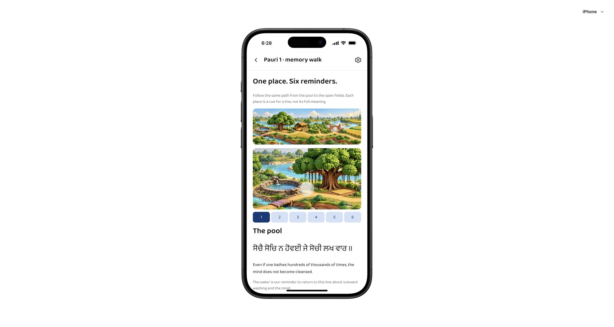
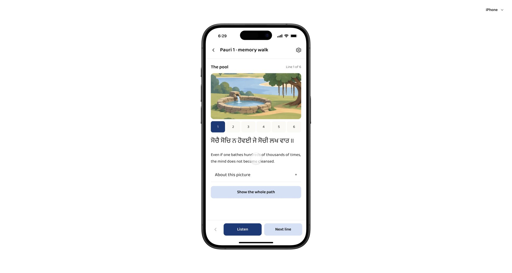
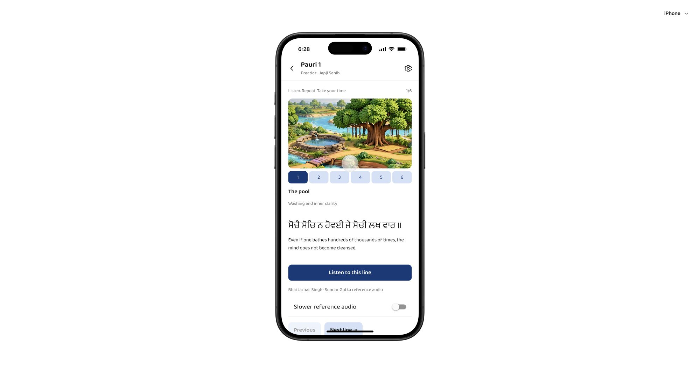
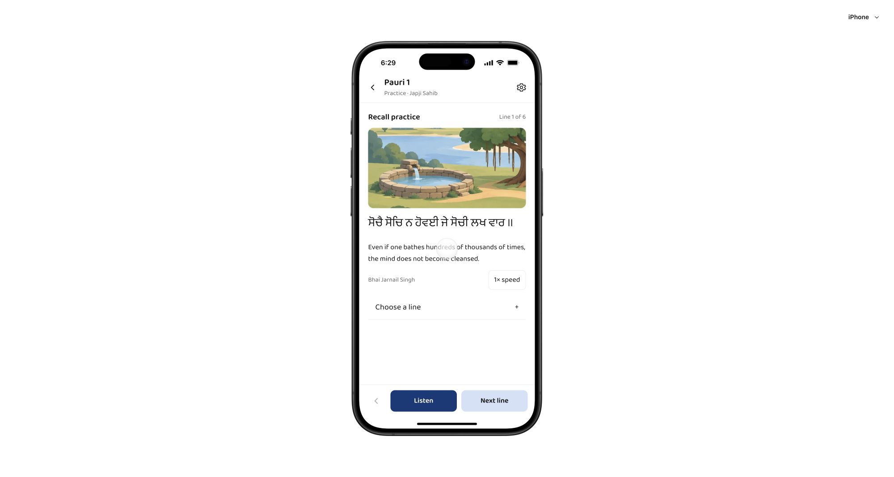
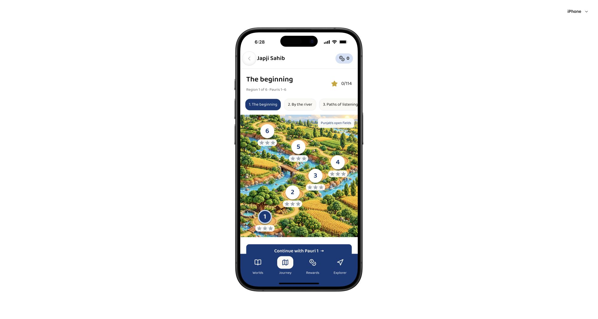
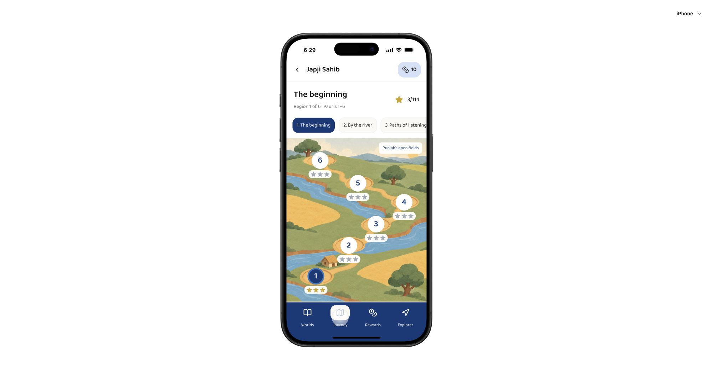

# Visual polish review

The current run captured the published version before editing and inspected the revised screens locally. The scope was story, practice and journey presentation. These screenshots support the visual findings; they do not establish full accessibility compliance.

## 1. Story

Before: two illustrations and introductory copy made the reading task secondary. Small numbered controls could be harder to tap.

After: one focused illustration, optional overview, larger touch targets and a fixed listening bar. The verse and meaning are visible at the default text size.

## 2. Practice

Before: helper labels and two separate line-navigation systems added clutter. The next-line control fell near the bottom edge.

After: a compact speed control, one expandable picker, larger English meaning and fixed controls. Recall practice still hides the words until requested.

## 3. Journey

Before: small leaves, flowers, crops and rocks competed with the interactive nodes.

After: flat terrain, open space and fewer objects make the numbered nodes and stars easier to distinguish. All six region-one nodes remain available.

## Verification

- Story stop selection updates the verse. Whole-path view and About this picture expand and collapse.
- Story-to-recall navigation, reveal, previous and next controls work.
- Illustrations can be turned off. Night mode and illustration preferences survive reload, along with previously earned stars and an equipped reward.
- The new playback-speed control starts slower reference audio, and next-line navigation stops it. The expandable line picker reaches the final line and then the challenge.
- iPhone and Pixel previews were visually inspected. This does not validate actual native devices.
- TypeScript, production build and all 28 protected runtime checks pass.
- Nine domain tests pass, including migration from a saved snapshot without the new illustration preference. Four Sites worker tests pass.
- The existing main-bundle advisory remains, approximately 731 KB before gzip and 225 KB gzip.

A development hot reload briefly invalidated the shared React context while editing its exports. A clean reload restored the app. Published builds do not use hot reload. Native screen-reader behavior, large accessibility text sizes and physical-device audio interruption still require testing.

The continuous challenge also completed after the UI changes. A repeated three-star result kept the best score and did not award additional coins.
